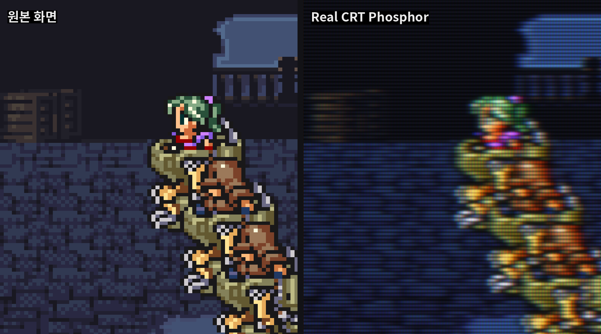
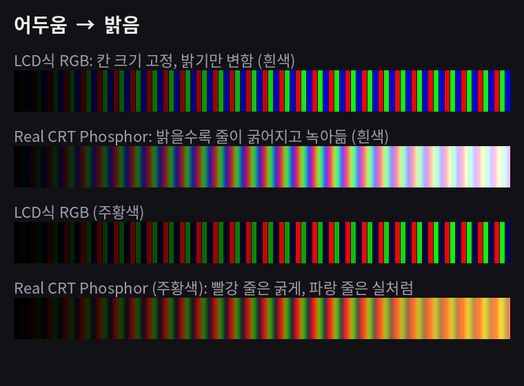
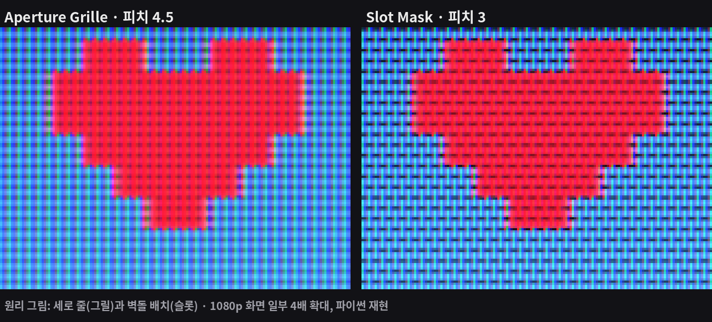
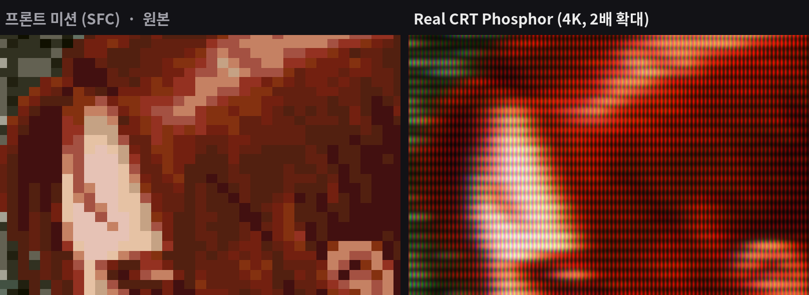
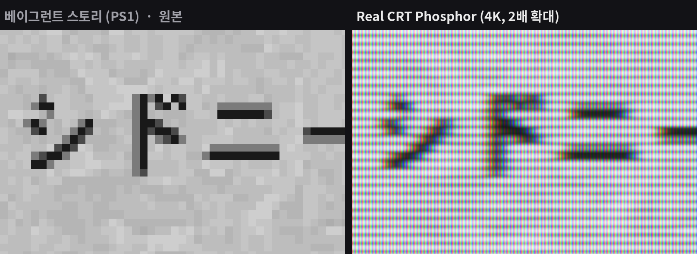

# Real CRT Phosphor

RetroArch용 CRT 셰이더 (slang) · A CRT shader for RetroArch (slang)

실제 브라운관을 가까이서 찍은 사진처럼, 화면이 **R·G·B 형광체 줄로만** 빛나게 만드는 셰이더입니다.

> AI 저작물 표시: 코드 대부분은 AI(Claude, ChatGPT)가 작성했고, 기획·화면 방향·실기 테스트·튜닝은 건군이 맡았습니다.

## 무엇이 다른가요

- **빛은 오직 형광체 줄에서만** 나옵니다. 원래 그림 위에 무늬를 덮는 방식이 아닙니다.
- **밝을수록 줄이 굵어집니다.** 색마다 줄 모양이 달라져 CRT 특유의 질감이 생깁니다.
- **아주 밝은 곳은 빛 덩어리로 녹아듭니다.** 빛의 총량은 유지되어 어두워지거나 탁해지지 않습니다.
- **두 가지 마스크:** Aperture Grille(세로 줄) / Slot Mask(벽돌 배치)

| | |
|---|---|
|  |  |

> 이미지는 원본 크기로 보세요. 축소하면 RGB 줄이 사라지거나 무늬가 생깁니다.

## 설치

1. [Releases](../../releases)에서 `real-crt-phosphor_v1.1.zip`을 받습니다.
2. 압축을 풀어 `real-crt-phosphor` 폴더를 `RetroArch/shaders/shaders_slang/` 안에 넣습니다.
3. 게임 실행 → Quick Menu → Shaders → Load
   - `presets/4K/` : 4K 모니터 · `presets/Ally/` : 1080p 휴대기기
   - 기종 이름만 있는 파일 = Aperture Grille, `-slot` = Slot Mask, `-ps2-2d` = PS2 2D 게임용
4. Save → Save Core Preset

비디오 드라이버는 Vulkan을 권장합니다 (glcore, D3D11 등 slang 지원 드라이버).
자세한 파라미터 설명은 [README_KR.txt](README_KR.txt), 프리셋 구조는 [presets/프리셋_사용법.txt](presets/프리셋_사용법.txt)에 있습니다.

## 이용 조건

- 비상업적 목적이면 자유롭게 사용·수정·재배포할 수 있습니다 (출처와 이용 조건 파일 포함).
- 상업적 이용은 사전 허락이 필요합니다.
- 공식 배포처(이 저장소의 Releases, 제작자 블로그)가 아닌 곳에서 받은 파일의 오류·바이러스 등은 책임지지 않습니다.
- 전문: [LICENSE_KR.txt](LICENSE_KR.txt) · [LICENSE.txt](LICENSE.txt)

---

## English

Makes the screen glow **only through R, G, B phosphor stripes**, like a close-up photo of a real CRT.
Bright stripes get wider and dark ones thinner, highlights melt into glow, and total light is preserved.
Two mask types: Aperture Grille and Slot Mask.

> AI-generated work notice: most of the code was written by AI (Claude, ChatGPT); concept, visual
> direction, real-device testing and tuning by gunkun.

**Install:** download `real-crt-phosphor_v1.1.zip` from [Releases](../../releases), copy the
`real-crt-phosphor` folder into `RetroArch/shaders/shaders_slang/`, then load a preset from
`presets/4K/` or `presets/Ally/` (`-slot` = slot mask, `-ps2-2d` = PS2 2D games).

**Terms:** free for non-commercial use, modification and redistribution with credit; commercial use
needs permission; no warranty; files from unofficial sources may be altered. See [LICENSE.txt](LICENSE.txt).
